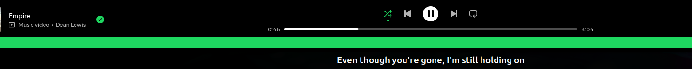

# Lyric Bar for Spotify

Synced lyrics in a slim bar at the bottom of your screen, so you can **sing along while you work**.

The bar stays on screen while you use other apps, and it **reserves its own space**: maximized windows stop above it instead of going underneath. It starts by itself at login, shows up when Spotify is open, and you can change its colours.



---

## Requirements

| You need | Details |
|---|---|
| **Ubuntu 24.04 or newer** | Any distro with **GNOME 45+** should work in principle, but this has only been tested on Ubuntu 24.04 (GNOME 46). |
| **Spotify as a Flatpak** | The Snap version does **not** work, see below. |
| **Python 3** with `requests` | Both are normally already installed on Ubuntu. |
| **Internet access** | Lyrics are downloaded from [LRCLIB](https://lrclib.net). |

### Does it work on Windows (or macOS)?

**No.** Lyric Bar is built on two Linux-only things: the D-Bus media-player interface (MPRIS) it uses to read what Spotify is playing, and a GNOME Shell extension that draws the bar. Neither exists on Windows or macOS, so it can't be ported by tweaking a setting. It would need a different program.

### Why the Flatpak version of Spotify?

Ubuntu's Snap version of Spotify runs in a sandbox that blocks other programs from reading its playback information, so Lyric Bar can't see what's playing. The Flatpak version doesn't have that restriction.

Check what you have:

```bash
snap list | grep -i spotify
flatpak list | grep -i spotify
```

If Spotify shows up under `snap`, switch to the Flatpak:

```bash
sudo snap remove spotify
sudo apt install flatpak
flatpak remote-add --if-not-exists flathub https://dl.flathub.org/repo/flathub.flatpakrepo
flatpak install flathub com.spotify.Client
flatpak run com.spotify.Client
```

Sign in again after switching; your playlists and library are stored in your Spotify account. The first time you install any Flatpak, the app may not show up in the Apps menu until you log out and back in. You can launch it with the last command in the meantime.

> The `.deb` version of Spotify from Spotify's own repository isn't sandboxed and will most likely work too, but it hasn't been tested here.

---

## Install

```bash
git clone https://github.com/MMuragu/spotify-lyrics-bar.git
cd spotify-lyrics-bar
bash install.sh
```

Then **log out and log back in** (a reboot also works). GNOME only picks up new extensions when a session starts, and the lyrics program is also started at login. Locking the screen or suspending is not enough.

Now open Spotify and play a song. The bar appears at the bottom within a few seconds. After this you never have to run anything by hand: the bar starts with your computer and shows up whenever Spotify is open.

Check that the extension loaded:

```bash
gnome-extensions info lyric-bar@local
```

It should say `State: ACTIVE`.

---

## Change the colours and size

Edit this file:

```
~/.config/spotify-lyrics/config.json
```

```json
{
  "background": "rgba(0, 0, 0, 0.85)",
  "color": "#ffffff",
  "font_size": 14,
  "height": 36,
  "bold": true
}
```

| Setting | What it does |
|---|---|
| `background` | Bar colour. Any CSS colour works: a name (`navy`), hex (`#1a1a2e`), or `rgba(r, g, b, opacity)` for see-through colours. |
| `color` | Lyric text colour, same formats. |
| `font_size` | Text size in points. |
| `height` | Bar height in pixels. |
| `bold` | `true` or `false`. |

Changes apply as soon as you save the file. If you don't see the change, log out and back in.

Some starting points:

```json
{ "background": "rgba(20, 20, 60, 0.92)", "color": "#ffd166", "font_size": 16, "height": 40, "bold": true }
```
```json
{ "background": "#1db954", "color": "#000000", "font_size": 14, "height": 36, "bold": true }
```
```json
{ "background": "rgba(255, 255, 255, 0.92)", "color": "#111111", "font_size": 14, "height": 36, "bold": false }
```

---

## Lyrics a little early or late?

Some songs have lyric timings that are slightly off. Open `lyrics.py` in this folder and change this line near the top:

```python
LYRIC_OFFSET = 0.0     # Seconds. Positive = show lyrics earlier, negative = later
```

Then run `bash install.sh` again and log out and back in.

---

## Troubleshooting

| Problem | Try this |
|---|---|
| **Nothing appears after install** | Log out,restart pc and back in. `gnome-extensions info lyric-bar@local` should then say `ACTIVE`. |
| **"Extension doesn't exist"** | Same as above: GNOME only scans for new extensions at login. |
| **Bar shows the song name but never lyrics** | The song has no synced lyrics in LRCLIB. This is common for new, small, or non-English releases. |
| **Bar doesn't show at all, extension is `ACTIVE`** | Check the lyrics program is publishing: `cat ~/.cache/spotify-lyrics/state.json` should show `"active": true` while Spotify plays. If the file is missing or says `false`, you most likely have the Snap version of Spotify (see above). |
| **Seeing errors from `gnome-shell`** | `journalctl -b /usr/bin/gnome-shell \| grep -i lyrics` |

Run the lyrics program by hand to see its messages:

```bash
python3 ~/.local/share/spotify-lyrics/lyrics.py --daemon
```

---

## Uninstall

```bash
bash uninstall.sh
```

Log out and back in afterwards. Your colour settings in `~/.config/spotify-lyrics/` are kept, so delete that folder if you want it gone.

---

## How it works

Two small pieces:

1. **`lyrics.py --daemon`** runs in the background. It reads the current track and playback position from Spotify over D-Bus, looks up synced lyrics on LRCLIB, works out which line is being sung, and writes it to `~/.cache/spotify-lyrics/state.json`.
2. **A GNOME Shell extension** (`extension/`) watches that file and draws the bar. It registers the bar with GNOME as reserved screen space, which is why windows never slide underneath it.

Running `python3 lyrics.py` without `--daemon` opens an older floating-window version instead. It needs `python3-tk` and can't reserve screen space on Wayland, so it will cover other windows.

## Privacy

To find lyrics, the song's title, artist, album and length are sent to [lrclib.net](https://lrclib.net). Nothing else is sent, and nothing is collected by this project.

## Credits and disclaimer

- Lyrics come from [LRCLIB](https://lrclib.net), a free community-built lyrics database.
- This is an independent hobby project. It is **not affiliated with or endorsed by Spotify**. "Spotify" is a trademark of its owner.

## License

[MIT](LICENSE)
